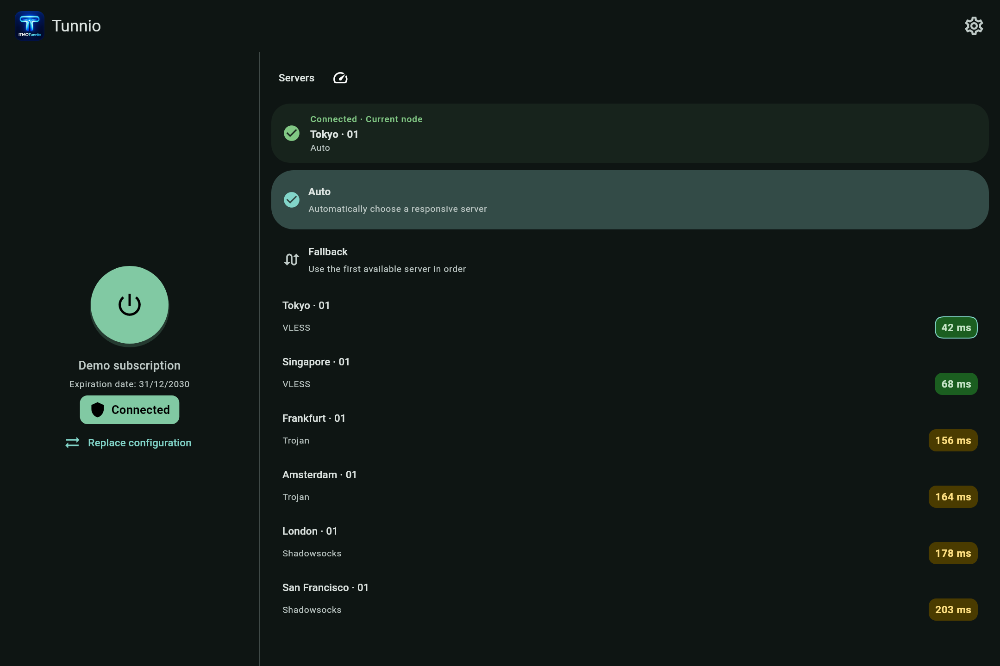
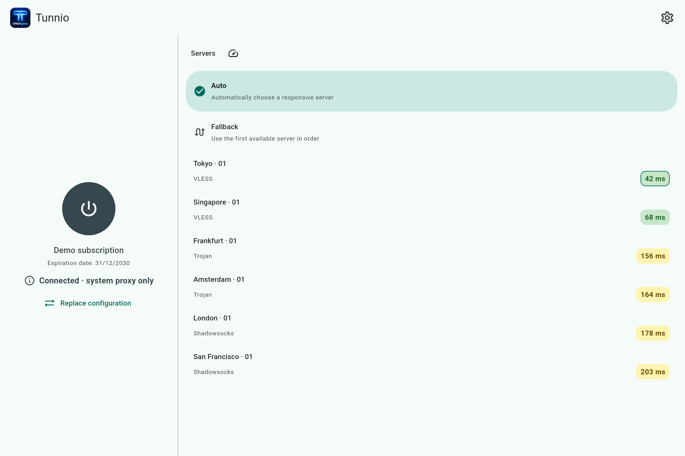
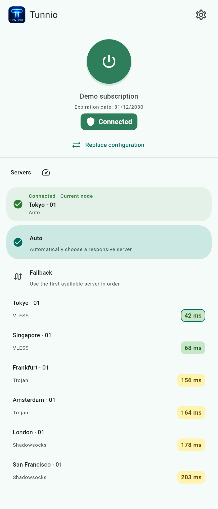
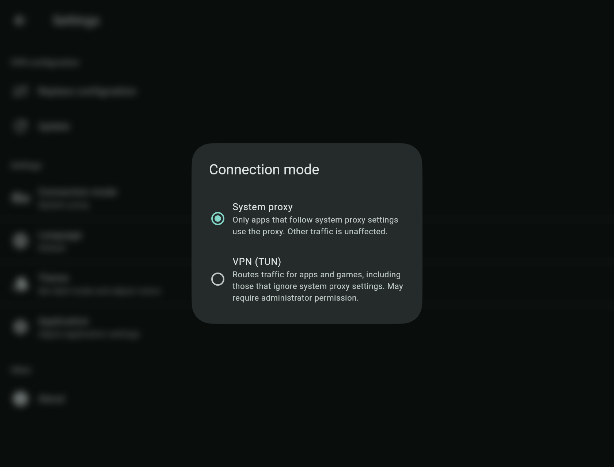

# Demo snapshots

[← Back to the README](../README.md)

These images are rendered from Tunnio's current Flutter widgets with an in-memory demonstration profile. They use the
app's color scheme, shapes, and default text scaling. Subscription names, server names, connection states, expiry, and
latency values are fictional. The generator does not connect to a provider or measure network performance.

Captures show app content without operating-system window chrome or status bars. The compact view demonstrates responsive
layout; it is not a device screenshot or a substitute for Android/Windows platform testing. The shared captures use English.

| Snapshot | Scene | Logical size |
| --- | --- | --- |
| [Desktop · dark](desktop-dark.png) | TUN connected, Auto selected, current node and latency results | 1080 × 720 |
| [Desktop · light](desktop-light.png) | System proxy only, Auto selected, latency results | 1080 × 720 |
| [Compact · light](mobile-light.png) | TUN connected with the controls above the server list | 412 × 960 |
| [Connection mode](connection-mode.png) | Desktop Settings dialog with System proxy selected | 840 × 640 |

All PNGs are captured at 2× resolution. Published app versions may differ from the source used to render them.

## Desktop · dark



## Desktop · light



## Compact layout and connection modes

<table>
  <tr>
    <td align="center"></td>
    <td align="center"></td>
  </tr>
</table>

## Regenerate

Use the Flutter version pinned in the [build workflow](../.github/workflows/build.yaml). From the repository root:

```bash
flutter pub get
flutter test tool/generate_snapshots.dart --dart-define=FLUTTER_SDK=/absolute/path/to/flutter --reporter expanded
```

Replace `/absolute/path/to/flutter` with the SDK directory containing `bin/flutter` (use forward slashes on Windows).
The generator loads Roboto and Material Icons from that SDK's cached fonts. Run `flutter precache` if the font cache is
missing. No extra font downloads or real subscriptions are needed.

For captures without native compilation, use the [temporary test-hook settings](../docs/BUILDING.md#tests-without-native-compilation),
then restore both flags to `true` afterward. The generator uses the widget-test runner and is invoked explicitly;
ordinary `flutter test` runs do not regenerate documentation images.

The command overwrites the four PNGs listed above. Inspect them for missing assets, clipped content, and unexpected
state before committing. Update both README language versions if the illustrated flow changes. Keep all fixture data
fictional; never replace it with a real subscription or credentials.

The older `preview.png` and `preview-dark.png` are legacy FlClash artwork and are not used as current Tunnio previews.
